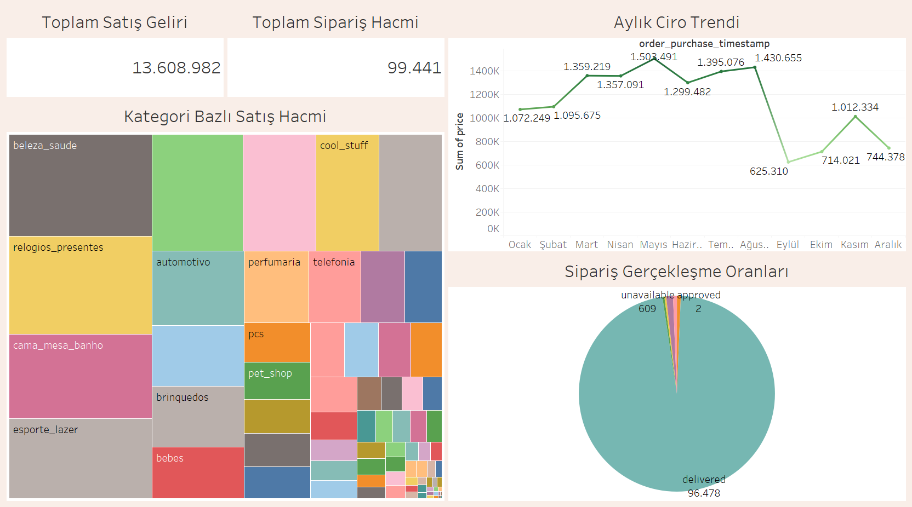
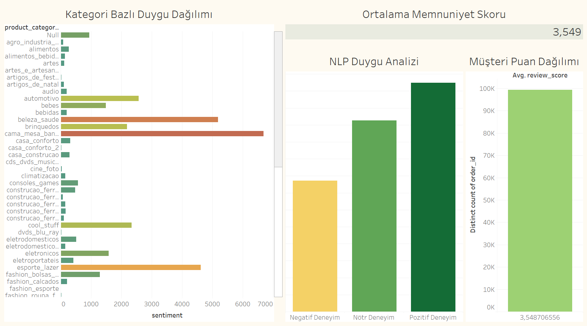
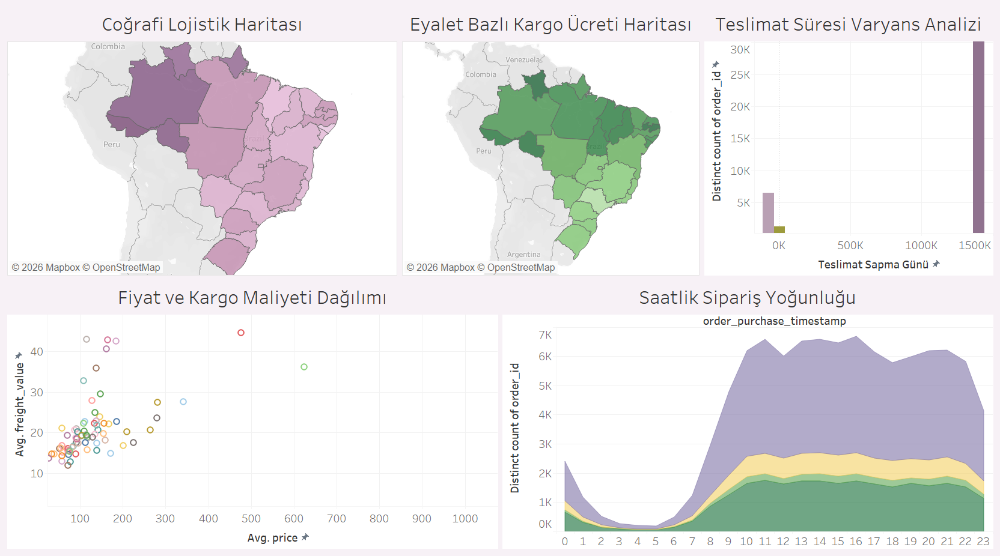
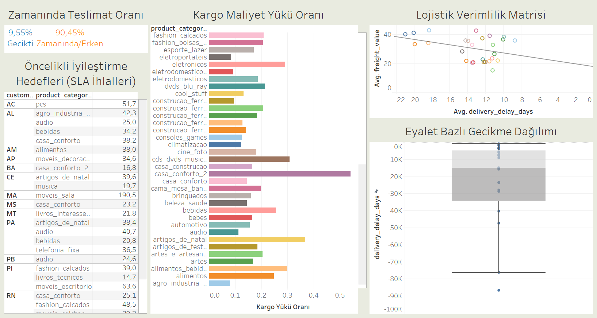

# Olist E-Commerce Data Analytics & Process Optimization Portfolio

Bu proje, Brezilya merkezli e-ticaret platformu Olist'in gerçek veri setleri kullanılarak uçtan uca veri mühendisliği (ETL) ve iş zekası (BI) mimarisinin kurulduğu kapsamlı bir analitik çalışmasıdır. Proje, yapılandırılmamış müşteri yorumları (NLP), sipariş süreçleri ve lojistik ağ verilerini anlamlı içgörülere dönüştürmeyi amaçlamaktadır.

---

## 📊 Dashboard 1: Satış Performansı ve Büyüme Trendleri

Executive özet niteliği taşıyan bu pano, Olist platformunun genel ticari sağlığını, hacmini ve kategori bazlı gelir dağılımını tek bir ekranda sunmaktadır.

* **Toplam Satış Geliri & Toplam Sipariş Hacmi:** 
  Platform, analiz edilen dönem içerisinde toplam **99.441** sipariş hacmine ulaşmış ve bu siparişlerden toplam **13.608.982** birim gelir elde etmiştir. Bu iki ana KPI, işletmenin işlem kapasitesini ve yarattığı finansal değeri özetler.

* **Aylık Ciro Trendi:** 
  Gelirlerin zaman içindeki dalgalanmasını gösteren bu çizgi grafikte, Mayıs ayında **1.503.491** birim ile en yüksek ciroya ulaşıldığı görülmektedir. Ağustos ayındaki (**1.430.655**) yüksek performansın ardından Eylül ayında (**625.310**) ciroda keskin bir düşüş yaşanmıştır. Bu kırılım, pazarlama kampanyalarının veya tedarik zincirindeki dönemsel etkilerin analiz edilmesi gerektiğini gösterir.

* **Kategori Bazlı Satış Hacmi:** 
  Cironun ürün kategorilerine göre oransal dağılımını gösteren ağaç haritasıdır. Platformun en çok gelir getiren kategorileri sırasıyla **Sağlık & Güzellik (beleza_saude)**, **Saat & Hediyelik (relogios_presentes)** ve **Yatak & Banyo (cama_mesa_banho)** olarak öne çıkmaktadır.

* **Sipariş Gerçekleşme Oranları:** 
  Siparişlerin güncel operasyonel durumunu gösteren pasta grafiktir. Alınan toplam siparişlerin çok büyük bir kısmı (**96.478** adet) başarıyla müşteriye teslim edilmiştir. İptal oranlarının grafikte çok küçük bir yer kaplaması, ilk sipariş alım ve onay süreçlerinin sağlıklı bir şekilde çalıştığını doğrulamaktadır.

## 🧠 Dashboard 2: Müşteri Deneyimi ve Duygu Analizi (NLP)

Bu pano, siparişlere bırakılan metin tabanlı müşteri yorumlarının Doğal Dil İşleme algoritmalarıyla analiz edilmesi sonucu elde edilen duygu durumlarını ve bu deneyimlerin ürün kategorileriyle olan ilişkisini sergilemektedir.

* **Ortalama Memnuniyet Skoru:** 
  Platformun genel müşteri memnuniyet ortalamasını gösteren ana KPI değeridir. 5 üzerinden **3.549** olarak gerçekleşen bu skor, müşteri deneyiminde iyileştirmeye açık alanlar olduğunu matematiksel olarak kanıtlamaktadır.

* **NLP Duygu Analizi:** 
  Makine öğrenmesi modelleriyle sınıflandırılan müşteri yorumlarının çubuk grafiğidir. "Pozitif Deneyim" sınıfı hacimsel olarak lider konumda olsa da, "Negatif Deneyim" ve "Nötr Deneyim" sınıflarının yüksekliği, salt satış metriklerinin ötesinde operasyonel problemler yaşandığına işaret etmektedir.

* **Kategori Bazlı Duygu Dağılımı:** 
  Duygu etiketlerinin ürün kategorilerine göre yoğunluğunu gösteren yatay dağılım grafiğidir. **cama_mesa_banho** (Yatak & Banyo), **beleza_saude** (Sağlık & Güzellik) ve **esporte_lazer** (Spor & Eğlence) kategorileri en yüksek yorum ve duygu hacmine sahip alanlar olarak öne çıkmaktadır. Kırmızı ve turuncu tonlu çubukların uzunluğu, hangi departmanların müşteri şikayetleriyle daha çok yüzleştiğini gösterir.

* **Müşteri Puan Dağılımı:** 
  Sipariş hacmine (yaklaşık 100K sipariş) karşılık gelen genel puan yığılmasını gösterir. Yüksek sipariş hacminin 3.54 ortalama etrafında şekillenmesi, veri setinde tutarlı bir memnuniyet/memnuniyetsizlik dağılımı olduğunu ifade eder.

## 🚚 Dashboard 3: Lojistik Ağı ve Operasyonel Darboğazlar

Bu pano, siparişten teslimata kadar geçen süreçteki coğrafi engelleri, maliyet dengesizliklerini ve zamanlama sapmalarını analiz etmektedir. Tedarik zincirindeki darboğazları tespit ederek, bir sonraki aşama olan ağ optimizasyonu için gereken kısıtları ve parametreleri belirlememizi sağlar.

* **Coğrafi Lojistik Haritası:** 
  Brezilya eyaletleri üzerindeki ortalama teslimat gecikmelerini gösterir. Koyu mor tonlar, altyapı veya mesafe kaynaklı lojistik darboğazların yaşandığı problemli rotaları temsil eder.

* **Eyalet Bazlı Kargo Ücreti Haritası:** 
  Teslimat haritasına paralel olarak ortalama kargo maliyetlerini gösterir. Gecikmelerin yaşandığı kuzey bölgelerindeki koyu yeşil tonlar, operasyonel verimsizliğin doğrudan müşteri maliyetine yansıdığını kanıtlamaktadır.

* **Teslimat Süresi Varyans Analizi:** 
  Tahmini teslimat tarihi ile gerçekleşen teslimat tarihi arasındaki farkların histogram dağılımıdır. Çoğu sipariş planlanan sürede teslim edilse de, sistemdeki istisnai gecikme vakaları ve erken teslimat yığılmaları bu dağılım eğrisinden takip edilebilir.

* **Fiyat ve Kargo Maliyeti Dağılımı:** 
  Ürün kategorilerinin ortalama fiyatı ile kargo maliyeti arasındaki ilişkiyi inceleyen dağılım grafiğidir. Ortalama fiyatı düşük olmasına rağmen kargo maliyeti çok yüksek olan (sol üst çeyreğe yaklaşan) kategoriler, acil lojistik iyileştirme gerektiren gruplardır.

* **Saatlik Sipariş Yoğunluğu:** 
  Siparişlerin günün saatlerine göre hacmini ve bu hacim içindeki müşteri duygu dağılımını gösteren alan grafiğidir. Gündüz ve akşam saatlerindeki sipariş yoğunluklarına göre müşteri deneyiminin nasıl şekillendiği görülmektedir.

## ⚙️ Dashboard 4: Süreç Optimizasyonu ve Verimlilik

Bu son pano, lojistik süreçlerdeki darboğazların finansal ve operasyonel etkilerini ölçerek doğrudan aksiyon alınabilecek "Öncelikli İyileştirme Hedefleri" sunmaktadır. Optimizasyon algoritmalarının hangi rotalarda ve kategorilerde çalıştırılması gerektiğini belirleyen temel rehberdir.

* **Zamanında Teslimat Oranı:** 
  Tüm siparişlerin teslimat performansı SLA (Hizmet Seviyesi Sözleşmesi) metriklerine göre değerlendirilmiştir. Siparişlerin **%90,45'i Zamanında/Erken** teslim edilirken, **%9,55'i Gecikmiştir**. Bu %9,55'lik dilim, optimizasyon çalışmalarının odak noktasını oluşturmaktadır.

* **Kargo Maliyet Yükü Oranı:** 
  Ürün kategorilerine göre kargo maliyetinin satış fiyatına oranını gösterir. Oranın yüksek olması (grafikte sağa doğru uzayan çubuklar), müşterinin ürünün kendisinden çok lojistiğine para ödediği verimsiz kategorileri (örneğin; *casa_conforto_2* ve *artigos_de_natal*) işaret etmektedir.

* **Lojistik Verimlilik Matrisi:** 
  Ortalama teslimat gecikmesi ve ortalama kargo ücretini karşılaştıran dağılım grafiğidir. Matrisin sol üst ve sağ üst alanlarında kalan noktalar, hem pahalı hem de yavaş işleyen en verimsiz lojistik kombinasyonlarını temsil eder.

* **Öncelikli İyileştirme Hedefleri (SLA İhlalleri):** 
  Dashboard'un eyleme dönüştürülebilir çıktı tablosudur. Ortalama gecikme süresi 5 günden fazla olan eyalet ve ürün kategorisi eşleşmelerini listeler (Örn: MA eyaletindeki *moveis_sala* kategorisi 190,5 günlük inanılmaz bir ortalama gecikme ile acil müdahale gerektirmektedir).

* **Eyalet Bazlı Gecikme Dağılımı:** 
  İstatistiksel süreç kontrolü için hazırlanan Kutu Grafiği, her eyaletteki teslimat sapmalarının medyanını, çeyreklik dilimlerini ve aykırı değerlerini göstererek varyansın en yüksek olduğu bölgeleri kanıtlamaktadır.